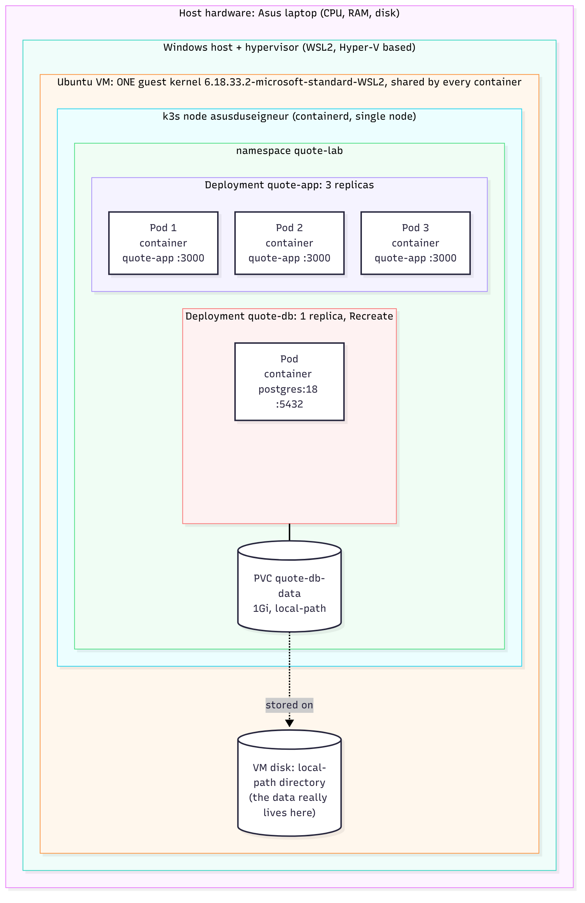
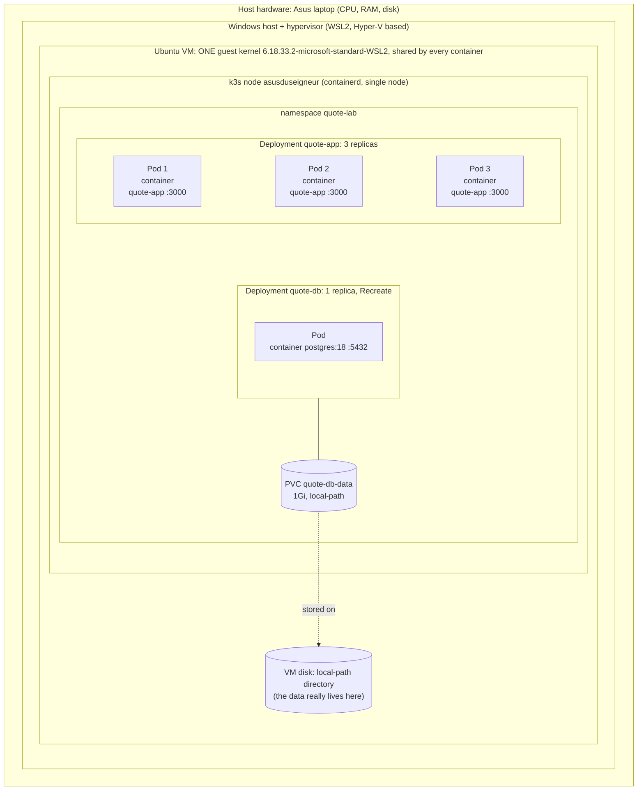
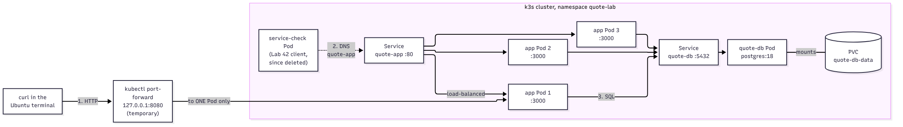
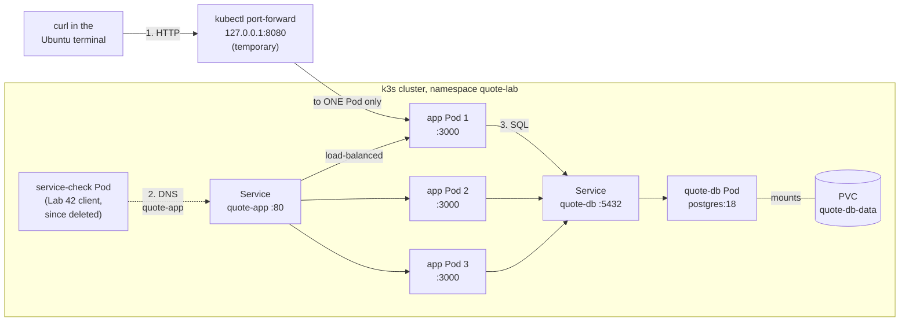

# Lab 52: Architecture notes

PostgreSQL is deployed in the cluster with persistent storage, the app is connected to it, and a quote survives a database Pod replacement. The Lab 42 evidence (health paths, three Ready replicas, Pod replacement, readiness failure and recovery, liveness extension) is in [`../42-kubernetes/42_verification.md`](../42-kubernetes/42_verification.md).

## Session checklist

- [x] PostgreSQL has a Bound PVC and a Ready Pod; the manifests reference a Secret, its values are not committed.
- [x] A distinct quote inserted through the app is still retrievable after the database Pod was replaced, using the same PVC.
- [x] Diagram of my actual setup (below).
- [x] Notes on the shared kernel, the persistence boundary, and the main limitation.
- [ ] Working manifests and selected evidence committed and pushed in my fork.

## 1. Current architecture

### 1a. What runs inside what

Nesting means "runs inside". Everything here is deployed; nothing is only planned.



<details>
<summary>Diagram source (Mermaid)</summary>



</details>

### 1b. Traffic paths

Arrows mean "sends requests to". I used `curl` in the same Ubuntu terminal, so there is no separate laptop-to-VM hop in my setup.



- **Path 1, temporary:** `kubectl port-forward svc/quote-app 8080:80` listens on `127.0.0.1:8080` and forwards to **one** app Pod. It does not demonstrate Service load balancing, and it dies when that Pod is replaced.
- **Path 2, Lab 42:** the `service-check` client Pod reached `http://quote-app/health` through cluster DNS and the Service (this Pod has since been deleted). This path does go through the Service.
- **Path 3:** the app Pods reach PostgreSQL through the `quote-db` Service. They get the address from `DATABASE_URL`, which comes from the Secret `quote-db-secret`. The database Pod mounts the PVC `quote-db-data`, and `init.sql` reaches it through the ConfigMap `quote-db-init`.

<details>
<summary>Diagram source (Mermaid)</summary>



</details>

## 2. Shared kernel

The app and database containers are ordinary processes on the Ubuntu VM. They are isolated from each other by namespaces and cgroups, but they all run on the **same guest kernel** (`6.18.33.2-microsoft-standard-WSL2`); a container does not bring its own kernel. The hypervisor provides the VM boundary between that guest kernel and the host hardware, and Kubernetes only manages the workloads inside the VM.

## 3. What survives replacement, and what survives VM loss

| Event | What happened | Evidence |
| --- | --- | --- |
| App Pod deleted (Lab 42) | The ReplicaSet created a replacement with a new name; the app is stateless, so nothing was lost. | `zgbjz` replaced by `bmfrp`, see Lab 42 section 3 |
| Database Pod replaced (`rollout restart`) | A new Pod started, mounted the **same PVC**, and the quote was still there. | Table below |
| VM or disk loss | Not tested, and not survivable: one node, one database instance, and the PVC is a `local-path` directory on the same VM disk. | Section 5 |

The quote survives Pod replacement because the data lives on the PVC, not in the Pod's own filesystem. Three app replicas and local-path storage on one VM give no recovery from VM or disk loss: there is no replication, no second node, and no backup.

## 4. Database evidence

The database is in `database.yaml`; the init script is in `db-init-configmap.yaml` and `init.sql`. The Secret was created with `kubectl` and is not in Git.

Storage and Pod:

```
$ kubectl get pvc quote-db-data
NAME            STATUS   VOLUME                                     CAPACITY   ACCESS MODES   STORAGECLASS   VOLUMEATTRIBUTESCLASS   AGE
quote-db-data   Bound    pvc-e4536f92-c243-4882-8857-04a80be29659   1Gi        RWO            local-path     <unset>                 73s

$ kubectl get pods -l app=quote-db
NAME                        READY   STATUS    RESTARTS   AGE
quote-db-796c9c9d49-2bpqc   1/1     Running   0          80s
```

The init script ran (three example quotes exist before my own insert), and the Secret exists (names and counts only, no values shown):

```
$ kubectl exec deployment/quote-db -- psql -U quote -d quotes -c SELECT count(*) FROM quotes;
 count
-------
     3

$ kubectl get secret quote-db-secret
NAME              TYPE     DATA   AGE
quote-db-secret   Opaque   4      8m16s
```

The app gets its connection string from the Secret:

```
$ kubectl describe deployment quote-app | grep -A1 DATABASE_URL
      DATABASE_URL:  <set to the key 'DATABASE_URL' in secret 'quote-db-secret'>  Optional: false
```

With the database connected, `/health` returns 200 and the rollout with the HTTP readiness probe succeeded:

```
$ curl -sS -i --max-time 5 http://127.0.0.1:8080/health
HTTP/1.1 200 OK
content-type: application/json; charset=utf-8

{"ok":true,"db":"up"}
```

```
$ kubectl get pods -l app=quote-app
NAME                         READY   STATUS    RESTARTS   AGE
quote-app-64c6f6d94f-64x8s   1/1     Running   0          20s
quote-app-64c6f6d94f-fs542   1/1     Running   0          14s
quote-app-64c6f6d94f-pkjn8   1/1     Running   0          26s
```

Persistence test with the unique marker `res509-1792399615`:

1. Inserted it through the app (`POST /quotes`, answered `302 Found`), then read the page back and found it:

   ```
   $ grep -F res509-1792399615 /tmp/res509-quotes.html
           <blockquote class="quote-text">res509-1792399615</blockquote>
   ```

2. Replaced the database Pod with `kubectl rollout restart deployment/quote-db`:

   | | Before | After |
   | --- | --- | --- |
   | Database Pod | `quote-db-796c9c9d49-2bpqc` | `quote-db-c994b966c-w5ns2` |
   | PVC `quote-db-data` | Bound, `pvc-e4536f92-…` | Bound, `pvc-e4536f92-…` (same volume) |
   | Marker in the page | found | found |

3. Read the page again after the replacement:

   ```
   $ grep -F res509-1792399615 /tmp/res509-quotes-after.html
           <blockquote class="quote-text">res509-1792399615</blockquote>
   ```

This proves the data survives replacement of the database **Pod** while the PVC stays. It does not prove recovery after VM or disk loss.

One side effect I observed: all three app Pods restarted once (`RESTARTS 1`) right after the database Pod was replaced, and all returned to `1/1`:

```
$ kubectl get pods -l app=quote-app
NAME                         READY   STATUS    RESTARTS      AGE
quote-app-64c6f6d94f-64x8s   1/1     Running   1 (29s ago)   9m7s
quote-app-64c6f6d94f-fs542   1/1     Running   1 (29s ago)   9m1s
quote-app-64c6f6d94f-pkjn8   1/1     Running   1 (29s ago)   9m13s
```

I have not looked at the previous container's logs, so the cause is not confirmed. My assumption is that the app does not handle its database connection dropping and exits.

## 5. Changes since Lab 42, and the main limitation

What changed from the Lab 42 limits:

- `/health` now returns `{"ok":true,"db":"up"}` instead of 503, because the database exists.
- The readiness probe went back from `tcpSocket` to `httpGet /health`, so a Pod is Ready only when the database answers.
- The liveness probe stays on `tcpSocket :3000` on purpose: `/health` queries the database, and a database outage should remove Pods from the Service, not restart them.
- This database work can also serve as the Lab 42 database extension (Lane D). My Lab 42 extension is Lane B (liveness probes).

**Main limitation:** everything runs on one VM, with one database instance whose data sits on that VM's disk. Losing the VM or the disk loses the data, and replacing the database Pod means a short downtime for the app.

**Next action:** take a `pg_dump` of the `quotes` database to a file outside the VM, then restore it into a fresh database to prove the backup works.
