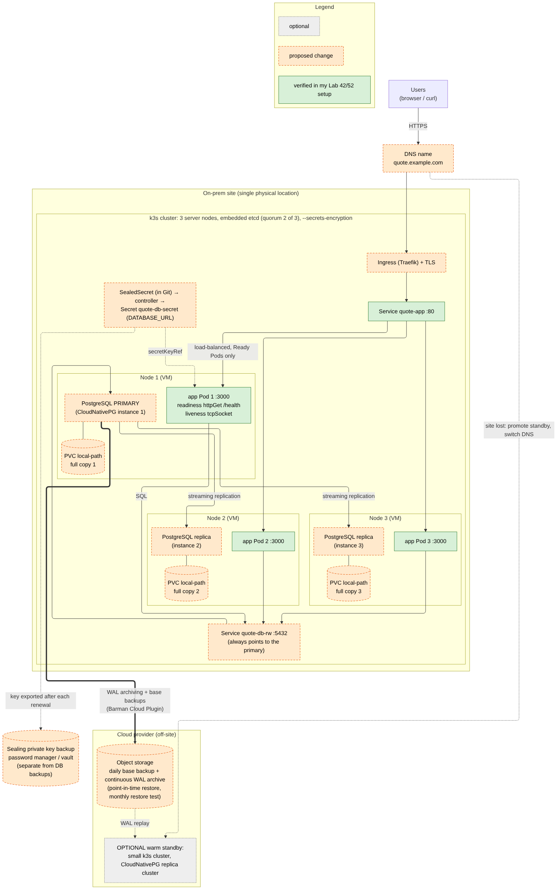
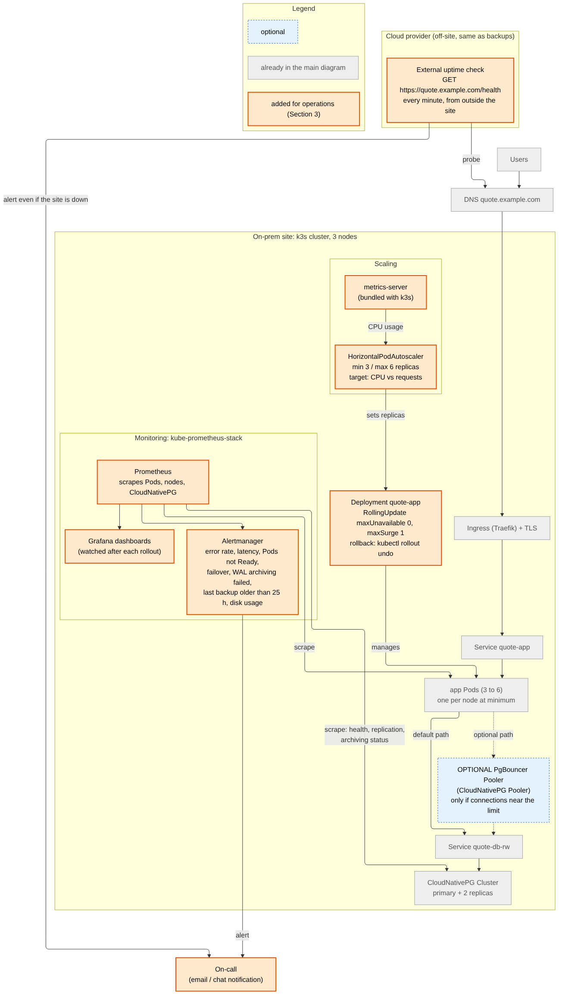

# Lab 62: Final architecture

Labels: **[verified]** = done and evidenced in my Lab 42/52 setup; **[proposed]** = design only, not deployed.

# Current System Problems

| # | Issue | Consequence | Fix |
| --- | --- | --- | --- |
| 1 | A single Pod runs the app | Any crash, node drain or update means a full outage; no horizontal scaling | Deployment with 3+ replicas behind a Service **[verified: 3 replicas on 1 node, Lab 42]** |
| 2 | PostgreSQL runs in the app container, data in the writable layer | Data is lost whenever the container is recreated; app and DB can't be scaled or updated separately (scaling the app would also duplicate the DB) | Separate PostgreSQL workload with its own Service and a PVC **[verified: Lab 52, quote survived DB Pod replacement]** |
| 3 | No readiness or liveness probes | Traffic goes to Pods that aren't ready; a hung process is never restarted | Readiness `httpGet /health` (checks the DB), liveness `tcpSocket :3000` **[verified: Lab 42/52]** |
| 4 | No resource requests or limits | One Pod can starve the node; the scheduler can't place Pods properly; OOM kills hit unpredictable victims | Set CPU/memory requests and a memory limit on every container **[proposed]** |
| 5 | Recreate strategy for the app | Every deployment causes downtime; a bad image takes the whole app down | `RollingUpdate` with `maxUnavailable: 0`, `maxSurge: 1`, gated by readiness **[proposed]** |
| 6 | DB credentials committed as literals in the manifest | Anyone with repo access has the password, and it stays in Git history | Only SealedSecrets in Git, unsealed by the cluster into a Secret referenced via `secretKeyRef`; rotate the leaked password **[secretKeyRef verified in Lab 52; SealedSecrets proposed]** |
| 7 | One node, one disk | Node or disk loss = total outage and total data loss | 3 nodes with app replicas and CloudNativePG instances spread one per node; off-site backups for site loss **[proposed]** |
| 8 | No tested backup/restore | Deletion, corruption or a bad migration can't be undone | Continuous WAL archiving + daily base backups to off-site object storage (point-in-time recovery), with a monthly restore test **[proposed]** |

# Production Architecture

Green = verified in my Lab 42/52 setup; orange dashed = proposed; grey dotted = optional.
Mermaid source: [architecture-final.mmd](architecture-final.mmd)

## Infrastructure

- **3 on-prem VMs**, each a k3s **server** node (embedded etcd needs an odd number for quorum; losing one node keeps the control plane up). **[proposed]**
- k3s installed with `--secrets-encryption`, so Secrets are encrypted at rest in etcd. This must be set at install time. **[proposed]**
- **Cloud object storage** (S3-compatible), outside the site: database base backups, WAL archive, and nothing else. **[proposed]**
- **Optional:** a small cloud k3s cluster running a CloudNativePG *replica cluster* as a warm standby, used only if the whole site is lost. **[proposed, optional]**

## Application

| Element | Design | Status |
| --- | --- | --- |
| Entry | Ingress (Traefik, bundled with k3s) with TLS → Service `quote-app` | Service **[verified]**, Ingress + TLS **[proposed]** |
| Workload | Deployment `quote-app`, 3 replicas | **[verified: 3 replicas on 1 node, Lab 42]** |
| Spread | `topologySpreadConstraints` on `kubernetes.io/hostname`: one replica per node | **[proposed]** |
| Disruptions | PodDisruptionBudget `minAvailable: 2` (node drains can't take down 2 replicas at once) | **[proposed]** |
| Rollout | `RollingUpdate`, `maxUnavailable: 0`, `maxSurge: 1`: a new Pod must be Ready before an old one stops | **[proposed]** |
| Probes | readiness `httpGet /health` (checks the DB), liveness `tcpSocket :3000` | **[verified, Lab 42/52]** |
| Resources | CPU/memory requests and a memory limit on every container | **[proposed]** |
| DB connection | `DATABASE_URL` from a Secret via `secretKeyRef`, pointing at Service `quote-db-rw` | `secretKeyRef` **[verified]**, `-rw` target **[proposed]** |

## Database

- **CloudNativePG** operator, `Cluster` `quote-db` with `instances: 3`: one primary and two streaming replicas, one per node. **[proposed]**
- The operator creates the Services: `quote-db-rw` (primary only, used by the app), `quote-db-ro` (replicas) and `quote-db-r` (any instance). **[proposed]**
- **Storage:** one `local-path` PVC per instance, on its own node. Each instance holds a full copy, so losing a node's disk loses only one copy. **[local-path verified in Lab 52; per-instance layout proposed]**
- **Automatic failover:** if the primary fails, the operator promotes a replica and moves `quote-db-rw` to it. **[proposed]**

## Secrets

- Credentials are committed only as **SealedSecrets** (encrypted with the cluster's public key, bound to name + namespace). The controller unseals them into normal Secrets. **[proposed]**
- The sealing private key is exported after each renewal (every 30 days) and stored **off-site, separately from the DB backups** (password manager/vault). Without it, a rebuilt cluster can't read the SealedSecrets. **[proposed]**
- RBAC limits who can read Secrets in `quote-lab`. Changes to SealedSecrets go through pull-request review. **[proposed]**
- The password committed in the original manifest is **rotated**: it stays readable in Git history. **[proposed]**

## Backup and restore

- **Barman Cloud Plugin** (the current CloudNativePG backup method; needs cert-manager): continuous **WAL archiving** plus a daily base backup (`ScheduledBackup`) to cloud object storage. **[proposed]**
- Recovery targets: lose at most a few minutes of data (RPO); be back within about an hour from object storage (RTO), or a few minutes with the warm standby. **[proposed]**
- **Restore test, monthly:** restore into a fresh `Cluster` to a chosen point in time, then check that the row counts and a known marker quote are there. A backup that was never restored doesn't count. **[proposed]**

## Failure boundaries

| Failure | What happens | Data |
| --- | --- | --- |
| **App Pod fails** | Readiness removes it from the Service; the ReplicaSet creates a replacement; 2 others keep serving | Not affected (stateless) **[verified, Lab 42]** |
| **DB primary Pod fails** | The operator promotes a replica; `quote-db-rw` follows it; the app reconnects (a few seconds of errors) | Kept (replicas). With async replication, the last uncommitted-to-replica writes may be lost |
| **One node / its disk lost** | App: the other 2 replicas keep serving, the third is rescheduled on a remaining node (Kubernetes waits ~5 min by default before evicting). DB: if it was the primary, failover as above; the lost instance is rebuilt from the primary onto a remaining node with a new PVC | Kept: the other two instances hold full copies. The dead node's PVC is gone, which doesn't matter |
| **Whole site lost** (all 3 VMs) | Everything on-prem is down. Recovery: new cluster + restore SealedSecrets key + restore DB from object storage, **or** promote the cloud warm standby and switch DNS | Kept up to the last archived WAL |
| **Human error / bad migration** (`DROP TABLE`) | Replicas copy the mistake immediately | Only **point-in-time recovery** from the backups to just before the mistake gets it back |

Two key distinctions:
- **A PVC is not a backup:** it lives on one disk, in the same site, and it faithfully stores mistakes. Only off-site WAL archives + base backups cover disk loss, site loss and human error.
- **Replicas on one node don't remove the node dependency.** Here, spreading app replicas and DB instances across 3 nodes is what removes it. The site itself is still a single point of failure, which the off-site backups (and optional standby) cover.

# Operational Strategy

Grey = already in the main diagram; orange = added for operations; blue dotted = optional.
Mermaid source: [architecture-operations.mmd](architecture-operations.mmd)

## How does the system scale?

- **App: horizontally.** It is stateless, so more Pods = more capacity. A **HorizontalPodAutoscaler** keeps between 3 and 6 replicas based on CPU (metrics-server is bundled with k3s; the HPA needs the CPU requests from Section 2). **[proposed]**
- **Database: vertically only for writes.** There is one primary; it grows with more CPU/RAM. Replicas (`quote-db-ro`) could serve reads, but the app currently uses a single `DATABASE_URL` to the primary.
- **Connections (optional):** each app Pod opens its own DB connections and Postgres has a connection limit. If the HPA pushes replica counts high enough to approach it, add a CloudNativePG **PgBouncer Pooler**. Not deployed by default: one more component to run and debug for a problem we don't have yet. **[proposed, optional]**
- **Nodes: fixed at 3.** On-prem there is no node autoscaler; beyond the 3 VMs' capacity, a VM must be added by hand.

## How are updates deployed safely?

- **Rolling update** (`maxUnavailable: 0`, `maxSurge: 1`): a new Pod must pass its readiness probe before an old one is removed, so a version that can't start or can't reach the DB never receives traffic and the rollout stalls instead of breaking the service.
- **Verify:** `kubectl rollout status deployment/quote-app`, a smoke test through the Ingress (`/health` + create and read a quote), then watch the error rate and latency in Grafana for a few minutes.
- **Roll back:** `kubectl rollout undo deployment/quote-app` returns to the previous ReplicaSet.
- **A rollback does not restore the database.** A Deployment revision only contains the Pod template (image, env, probes). Rows written, deleted or corrupted by the bad version stay as they are, and a schema migration is not reversed. Therefore:
  - Schema changes follow **expand/contract**: add new columns/tables first, release the app using them, remove old ones only in a later release. The previous app version keeps working against the new schema, so an app rollback is always possible.
  - **Decision rule:** bad code, good data → roll back the app. Bad data → point-in-time restore to just before the deploy (then roll back the app too).

## How are failures detected?

- **Pods:** readiness probe (`/health`, includes the DB) removes a Pod from the Service; liveness probe (`tcpSocket`) triggers a restart. **[verified, Lab 42/52]**
- **Nodes:** kubelet heartbeats; a node that stops reporting is marked `NotReady`.
- **Database:** the CloudNativePG operator checks instance health and triggers failover.
- **Monitoring:** `kube-prometheus-stack` (Prometheus + Alertmanager + Grafana) with CloudNativePG metrics. Alerts on: HTTP error rate and latency, Pods not Ready / restarting, DB failover, **WAL archiving failures and last base backup older than 25 h**, disk usage on the nodes. **[proposed]**
- **External uptime check, hosted in the cloud:** requests `https://quote.example.com/health` from outside every minute. It catches what in-cluster monitoring can't: DNS/TLS/Ingress problems and the whole site being down (when in-cluster monitoring goes down with it). **[proposed]**

## Which Kubernetes controllers handle recovery?

| Problem | Recovered by |
| --- | --- |
| App Pod crashes or is deleted | **ReplicaSet** (owned by the Deployment) recreates it; the **scheduler** places it on a healthy node |
| Container hangs | **kubelet** restarts it (liveness probe) |
| Unready Pod still in the Service | **EndpointSlice controller** removes it until it is Ready again |
| Node lost | **Node lifecycle controller** marks it `NotReady` and evicts its Pods (~5 min by default); the ReplicaSet recreates them elsewhere |
| DB primary or instance lost | **CloudNativePG operator**: promotes a replica, repoints `quote-db-rw`, rebuilds the lost instance |
| Secret deleted | **Sealed Secrets controller** recreates it from the SealedSecret |
| Control plane node lost | **etcd quorum** (2 of 3) keeps the API available |

**What no controller fixes:** loss of the whole site (all VMs and disks), bad data written by the app or a human (`DROP TABLE`, bad migration), loss of the sealing key, and the VMs/hardware themselves. These need the **backup/restore procedure** (base backup + WAL to a point in time, sealing key from the vault) and **infrastructure recovery** (rebuild the VMs and k3s, or promote the cloud standby).

# Weakest Point

**The single write primary.** Every write from every app Pod goes to one PostgreSQL instance through `quote-db-rw`. The replicas protect the data and take over on failure, but they do not share the write load.

**Why it is the weakest point:** everything else in the design scales or heals around it. The app scales out with the HPA; nodes and Pods are replaced by controllers. The primary only scales vertically (bigger VM), and the 3 nodes are a fixed ceiling on-prem.

**Where it fails first under stress:**
1. Traffic rises → the HPA adds app Pods (up to 6).
2. Each new Pod opens its own DB connections → the primary approaches its connection limit, and its CPU and disk I/O saturate.
3. Queries slow down → `/health` (which queries the DB) gets slow or fails → readiness removes app Pods from the Service → fewer Pods carry the same traffic → more timeouts. A database bottleneck turns into an app outage.

**Made worse by a verified behaviour:** in Lab 52, all 3 app Pods restarted when the DB Pod was replaced. With automatic failover, a promotion under load would restart every app Pod at the same time, right when capacity is needed most.

**Mitigations and their tradeoffs:**
- PgBouncer pooler (already optional in Section 3) → caps connections; one more component to run.
- Bigger primary VM → simple; limited by the hardware and requires a planned failover to resize.
- Send read queries to `quote-db-ro` → spreads reads; needs app changes, and replicas may return slightly stale data.
- Fix the app to reconnect instead of exiting when the DB connection drops → removes the restart storm on failover; needs a code change.

**Accepted risk: the site.** All 3 nodes are in one location. Off-site backups (and the optional cloud standby) protect the data, but recovering service after a site loss is manual. The tradeoff goes both ways: on-prem hardware can be physically reached and repaired quickly (no waiting on a provider), but that requires someone on site, and it does nothing against a power, network or building-level outage.

## Stretch question: what breaks first under 10× traffic?

The database primary, as described above: the HPA tops out at 6 app Pods, which is not 10×, and long before more app Pods could help, the single primary runs out of connections and I/O. Next in line would be the 3 fixed nodes' CPU/RAM. The Ingress and app layer are not the first limit.
